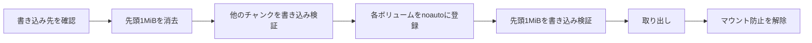

<div align="center">

<h1>kakikomi</h1>

<strong>ディスクイメージをフロッピー、Zipディスク、USBメモリ、ハードディスクにチャンクごとに検証しながら書き込み、システムにマウントさせません。</strong>

[English](README.md) | 日本語 | [简体中文](README.zh-Hans.md) | [繁體中文 (香港)](README.zh-HK.md)

[](https://github.com/gufranco/kakikomi/actions/workflows/ci.yml)
[](https://github.com/gufranco/kakikomi/releases)
[](LICENSE)
[](#portability)

<p align="center">
  <a href="#quick-start"><strong>クイックスタート</strong></a> |
  <a href="#never-mounted">マウントさせない仕組み</a> |
  <a href="#kiyome">kiyome</a> |
  <a href="#development">開発</a>
</p>

</div>

コマンドは2つ、テストは40件、シェルのモジュールは13個で、POSIXシステム以外に実行時の依存はありません。`kakikomi`はディスクへの「書き込み」、`kiyome`は「清め」で、ディスクをきれいに消去します。

---

```console
$ kakikomi debian.img.xz /dev/disk4
Image:  debian.img.xz
        xz, 1.4 GiB (1501560832 bytes)
Target: /dev/disk4, 14.9 GiB, SANDISK ULTRA
Type disk4 to write, or anything else to stop: disk4
Blanking the first 1.0 MiB so nothing on /dev/disk4 is mountable until the very end.
Told macOS not to mount the 2 volume(s) in this image.
Writing the first 1.0 MiB last.
Wrote and verified every chunk of the image.
Validated: /dev/disk4 matches the image, SHA-256 9f86d081884c7d65...
Ejected. /dev/disk4 is safe to remove.
```

<a id="quick-start"></a>

## クイックスタート

### 前提条件

| ツール | 用途 | インストール |
|:-----|:----|:--------|
| POSIX `sh`、`dd`、`cmp`、`od` | ツール本体 | macOSとLinuxにプリインストールされています。`bash`は不要です |
| `openssl` | kiyomeのチャンクごとのランダムパターン | プリインストールされています |
| `gzip`、`xz`、`zstd`、`bzip2` | 圧縮イメージ | 書き込む形式の分だけ必要です |
| `bsdtar`または`7z` | `.zip`イメージとWindowsのISO | Linuxでは`libarchive-tools`または`p7zip-full` |
| `qemu-img` | `.vhd`、`.vhdx`、`.vmdk`、`.qcow2` | `brew install qemu`または`apt install qemu-utils` |
| `mtools`、`wimlib` | WindowsのISOと`kakikomi format` | Homebrewのformulaで入ります。Linuxでは`apt install mtools wimtools` |

### インストール

```bash
brew install gufranco/tap/kakikomi
```

ソースからもインストールできます。

```bash
git clone https://github.com/gufranco/kakikomi.git
cd kakikomi
make install
```

`make install`はツールを`~/.local`の下にコピーし、`kakikomi`と`kiyome`を`~/.local/bin`に置きます。場所は`PREFIX`で変えられます。

### 確認

```console
$ kakikomi --version
kakikomi 1.0.0
```

## 使い方

| コマンド | 用途 |
|:--------|:--------|
| `kakikomi <image\|url\|device> [target...]` | イメージを1台以上のディスクに書き込みます。書き込み先を省くと、選べるリムーバブルディスクを一覧表示します |
| `kakikomi <windows.iso> <target>` | WindowsのインストールISOを、UEFIで起動できるFAT32のUSBメモリとして配置します |
| `kakikomi format <target> [fat32\|exfat\|fat\|floppy] [LABEL]` | クイックフォーマット。新しいファイルシステムの構造だけを書き込みます |
| `kakikomi --release` | 実行時に残ったマウント防止の設定を取り除きます |
| `kiyome <target>` | 検証付きの5つのパターンでディスクを上書きします |
| 引数なしの`kakikomi`または`kiyome` | ターミナルで実行すると、必要な値を順に尋ねます |
| `kakikomi doctor`、`kiyome doctor` | それぞれが必要とするツールと、インストール状況を一覧表示します |
| `kakikomi version`、`kakikomi help` | バージョンまたは使い方の全文を表示します。kiyomeも同じです |

| 入力 | 読み方 |
|:-------|:---------------|
| `.img`、`.iso`、`.bin`、`.raw`、`.dsk`、`.ima` | そのまま |
| `.gz`、`.xz`、`.zst`、`.bz2` | ストリームで読み、ディスクには展開しません |
| イメージを1つだけ含む`.zip` | `bsdtar`でストリームとして読みます |
| `.dmg`、`.vhd`、`.vhdx`、`.vmdk`、`.qcow2` | 空き容量を確認してから、先にrawへ変換します |
| `http://`または`https://`のURL | 再開可能なダウンロードのあと、ファイルとして読みます |
| `/dev/...` | そのドライブから複製し、そのドライブもマウントさせません |

| 変数 | 効果 |
|:---------|:-------|
| `VERIFY=n` | 最後のディスク全体のSHA-256比較を省きます。未設定なら確認されます |
| `DELETE=y` | すべてのディスクの検証が通ったら、イメージをゴミ箱に移します。読み戻していない場合は無視されます |
| `AGAIN=y` | 次に挿したディスクにも同じイメージを書き込みます |
| `REINSERT=y` | 取り出したあと、ディスクが戻るのを待って再度比較します |
| `ZERO_TAIL=y` | 大きいディスクで、イメージより後ろの領域を消去します |
| `SHA256=<hash>` | イメージが一致しなければ止めます。隣にある`.sha256`や`SHA256SUMS`は自動で読みます |
| `ALLOW_INTERNAL=y` | 内蔵ディスクを許可します。動作中のシステムがあるディスクは常に拒否されます |
| `KEEP_GUARD=y` | 実行後もfstabの設定を残し、このMacがそのディスクを今後もマウントしないようにします |
| `MODE=raw` | WindowsのISOをFAT32に配置せず、そのまま書き込みます |

```bash
kakikomi debian.img.xz /dev/disk4 /dev/disk5     # two sticks at once
kakikomi https://example.org/os.img.gz            # pick the target from a list
kakikomi /dev/disk4 /dev/disk5                    # clone disk4 onto disk5
AGAIN=y kakikomi game.ima /dev/disk6              # a batch of floppies
kakikomi format /dev/disk4 exfat MEDIA
```

<a id="never-mounted"></a>

## マウントさせない仕組み

macOSはFATのボリュームをマウントすると、ほんの一瞬でも`.fseventsd`、`.Spotlight-V100`、`._`のファイルを書き込みます。そのため、レトロな機器のために書いたディスクが変わって戻ってきます。kakikomiはシステムを寄せ付けません。



| 手順 | 詳細 |
|:-----|:-------|
| 最後までマウントできるものがない | 先頭1MiBが空なので、パーティションテーブルもブートセクタもなく、DiskArbitrationもudisksもボリュームを見つけられません |
| 現れる前に登録 | macOSでは、`-nomount`で接続したヘッダーだけのコピーから各ボリュームのUUIDを読み、`/etc/fstab`に`noauto`として書きます。Linuxではそのデバイスに`UDISKS_IGNORE`のudevルールを置きます |
| 監視 | 実行中にマウントが見つかると失敗とし、システムが作ったファイルを示します |
| 確認 | `REINSERT=y`は、抜き差ししたあとにディスク全体を読み戻します |

途中で止めた実行でも先頭1MiBは空のままなので、書きかけのディスクもマウントできません。

## 最初の問題で止まる

各チャンクは書き込み、読み戻し、比較してから次へ進みます。kakikomiはまずディスク自体の速度を測り、その値から各転送の期限を決めます。不一致、停止、デバイスの消失があるとそのディスクを止めて取り出し、誤ったビット線を表示します。

| ドライブ | 扱い |
|:------|:----------|
| Zip、Jaz、PocketZip | 期限を短くし、再試行しません。停止はヘッドのずれとみなします。ずれたヘッドは次に入れたカートリッジを傷めます |
| フロッピー、SuperDisk | 再試行しません。ソフトウェアで取り出せないドライブなので、ディスクを抜くまで待ちます |
| その他 | チャンクごとに3回試してから止めます |

書き込み先が複数あるときは、ディスクごとに別のワーカーが書き込み、1台の失敗が他を止めることはありません。

## Windowsのインストーラー

WindowsのISOはそのまま書いてもUSBからは起動しません。kakikomiはそれを検出し、すべてのファイルを含むFAT32パーティション1つのMBRディスクを作り、4GiBを超える`install.wim`は`wimlib`で分割します。ファイルは`mtools`でコピーするので書き込み先はマウントされず、ボリュームを書き込む前に全ファイルを読み戻して比較します。できたものはUEFIのマシンで起動します。

<a id="kiyome"></a>

## kiyome

```console
$ kiyome /dev/disk4
This will ERASE all data on /dev/disk4. Continue? (y/N): y
Pass 1 of 1
Writing per-chunk unique data over 4 chunks, timing every chunk
Verify per-chunk unique data completed
Verify 0xAA completed
Verify 0x55 completed
Verify 0xFF completed
Verify 0x00 completed
Device ejected successfully
```

1回のパスで5つのパターンを書き込んで読み戻します。チャンクごとに異なるAES-CTRのデータ、続いて`0xAA`、`0x55`、`0xFF`、`0x00`です。誤ったバイトは関係するビット線とともに報告され、ケーブルやアダプターのデータ線の固着と、媒体の劣化を見分けられます。`PASSES=N`で繰り返し、`CREATE=y`で新しいFATかexFATのファイルシステムを残します。

<a id="portability"></a>

## 移植性

すべてPOSIX `sh`で書かれ、ShellCheckの`-o all`で指摘ゼロ、無効化したチェックもありません。テストはmacOSの`/bin/sh`、`dash`、`bash`、`bash --posix`、`zsh`と、特権コンテナ内のUbuntuの同じシェルで実行します。

<a id="development"></a>

## 開発

| コマンド | 説明 |
|:--------|:------------|
| `make lint` | すべてのスクリプトにShellCheck |
| `make test` | システムの`sh`で40件の`bats`テスト |
| `make test-all` | インストール済みのすべてのシェルで同じテスト |
| `make test-linux` | Macから、特権付きUbuntuコンテナで同じテスト |
| `make coverage` | このMacと同じコンテナでbashcovによる行カバレッジを測定して統合します。CIは100%を必須にします |

テストは`hdiutil`や`losetup`でファイルを使ったディスクを接続して実際に書き込み、Linuxでは`dmsetup`でI/Oエラーを注入します。CIはUbuntuとmacOSで実行します。`main`へのpushごとにsemantic-releaseが動き、`feat`か`fix`のコミットがあればリリースを公開し、[`lib/core.sh`](lib/core.sh)の`KAKIKOMI_VERSION`とCHANGELOGを更新して、Homebrewのformulaも更新します。

## ライセンス

[MIT](LICENSE)
