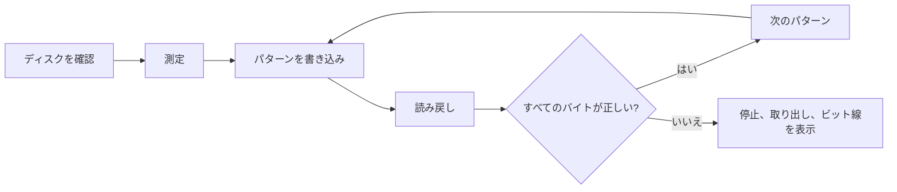

<div align="center">

<h1>kiyome</h1>

<strong>フロッピー、Zipディスク、USBメモリ、ハードディスクを検証付きの5つのパターンで消去し、故障しているビット線を示します。</strong>

[English](README.md) | 日本語 | [简体中文](README.zh-Hans.md) | [繁體中文 (香港)](README.zh-HK.md)

[](https://github.com/gufranco/kiyome/actions/workflows/ci.yml)
[](https://github.com/gufranco/kiyome/releases)
[](LICENSE)
[](#portability)

<p align="center">
  <a href="#quick-start"><strong>クイックスタート</strong></a> |
  <a href="#how-it-works">仕組み</a> |
  <a href="#development">開発</a>
</p>

</div>

コマンドは1つ、テストは156件、シェルのモジュールは9個で、POSIXシステム以外に実行時の依存はありません。`kiyome`は日本語の「清め」です。姉妹ツールの[kakikomi](https://github.com/gufranco/kakikomi)はディスクイメージを書き込みます。

---

```console
$ kiyome /dev/disk6

Device: /dev/disk6, 64.0 MiB, DISK IMAGE
        Everything on it is erased, including:
          +67.1 MB disk6
Plan:   1 pass of unique data, 0xAA, 0x55, 0xFF and 0x00, each read back
        then eject

Type disk6 to erase, or anything else to stop: disk6
Unmounting /dev/disk6...
Disk unmounted
Measuring /dev/disk6 before wiping it, so every limit comes from this disk.
Measured read: 222666 KiB/s sustained, 26ms to reach a sector, allowing 3x that before stopping.
Measured write: 27028 KiB/s sustained, 27ms to reach a sector, allowing 3x that before stopping.
Pass 1 of 1, writing per-chunk unique data 100%  438.4 MiB/s  0m00s left
Pass 1 of 1, verifying per-chunk unique data 100%  237.9 MiB/s  0m00s left
Pass 1 of 1, writing 0xAA 100%  888.9 MiB/s  0m00s left
Pass 1 of 1, verifying 0xAA 100%  400.0 MiB/s  0m00s left
Pass 1 of 1, writing 0x55 100%  941.2 MiB/s  0m00s left
Pass 1 of 1, verifying 0x55 100%  240.6 MiB/s  0m00s left
Pass 1 of 1, writing 0xFF 100%  888.9 MiB/s  0m00s left
Pass 1 of 1, verifying 0xFF 100%  390.2 MiB/s  0m00s left
Pass 1 of 1, writing 0x00 100%  711.1 MiB/s  0m00s left
Pass 1 of 1, verifying 0x00 100%  280.7 MiB/s  0m00s left
Wiped /dev/disk6: every byte of every pattern read back as written.
Ejecting /dev/disk6...
Ejected. /dev/disk6 is safe to remove.
```

<a id="quick-start"></a>

## クイックスタート

### 前提条件

| ツール | 用途 | インストール |
|:-----|:----|:--------|
| POSIX `sh`、`dd`、`cmp`、`od` | ツール本体 | macOSとLinuxにプリインストールされています。`bash`は不要です |
| `openssl` | チャンクごとに異なるパターン | プリインストールされています |
| `newfs_msdos`、または`sfdisk`と`mkfs.fat` | macOSまたはLinuxでの`--create` | macOSにはプリインストール済み。Linuxでは`apt install fdisk dosfstools` |
| `mkfs.exfat` | Linuxで32GiBを超えるディスクへの`--create` | `apt install exfatprogs` |

### インストール

```bash
brew install gufranco/tap/kiyome
```

ソースからもインストールできます。

```bash
git clone https://github.com/gufranco/kiyome.git
cd kiyome
make install
```

`make install`はツールとmanページ、bash・zsh・fishの補完を`~/.local`の下にコピーし、`kiyome`を`~/.local/bin`に置きます。場所は`PREFIX`で変えられます。Homebrewのformulaも同じファイルをインストールします。

### 確認

```console
$ kiyome doctor
dd                 ok       /bin/dd, bsd
cmp                ok       /usr/bin/cmp, bsd
od                 ok       /usr/bin/od, bsd
awk                ok       /usr/bin/awk, bsd 20200816
sed                ok       /usr/bin/sed, bsd
sudo               ok       /usr/bin/sudo
sha256sum|shasum   ok       /sbin/sha256sum, bsd 1.0
diskutil           ok       /usr/sbin/diskutil
hdiutil            ok       /usr/bin/hdiutil
openssl            ok       /usr/bin/openssl
```

## 使い方

| コマンド | 用途 |
|:--------|:--------|
| `kiyome [options] <device\|mount_point>` | そのディスクを検証付きの5つのパターンで上書きし、取り出します |
| 引数なしの`kiyome` | ターミナルで実行すると、ディスクとパスの回数を尋ねます |
| `kiyome doctor` | kiyomeが必要とするツールと、インストール状況を一覧表示します |
| `kiyome version`、`kiyome help` | バージョンまたは使い方の全文を表示します |

| オプション | 効果 |
|:-------|:-------|
| `--passes N` | 5つのパターンをN回繰り返します。既定は1回です |
| `--create` | 空のディスクではなく、新しいFAT32またはexFATのファイルシステムを残します |
| `--allow-internal` | 内蔵ディスクを許可します。動作中のシステムがあるディスクは常に拒否されます |

`--passes=3`の形も使え、`--`でオプションが終わります。環境変数`PASSES=N`、`CREATE=y`、`ALLOW_INTERNAL=y`も同じ設定になり、コマンドラインのオプションが優先されます。

```bash
kiyome /dev/disk4                 # 1パスのあと取り出し
kiyome --passes 3 /dev/sdb        # 3パス
kiyome /Volumes/USB               # マウント中のボリュームはディスク全体を指す
kiyome --create /Volumes/USB      # FAT32またはexFATのファイルシステムを残す
```

ディスクはデバイス名（`/dev/disk4` など）でも、そのディスクからマウントされたボリューム（`/Volumes/USB` など）でも指定できます。kiyome はボリュームの背後にあるディスク全体を突き止め、全体を消去します。

kiyomeはファミリー共通のコマンドライン規約に従います。内容は[FAMILY.md](FAMILY.md)にあります。

<a id="how-it-works"></a>

## 仕組み

1回のパスで5つのパターンを書き込み、それぞれを読み戻してから次へ進みます。チャンクごとに異なるAES-CTRのデータ、続いて`0xAA`、`0x55`、`0xFF`、`0x00`です。固有のデータは、キャッシュから応答するディスクや、2つのアドレスを同じ場所に割り当てるディスクを見つけます。4つの固定パターンは、すべてのビットを0と1の両方に保ちます。

誤ったバイトは関係するビット線とともに報告されます。常に同じ1本が誤るなら、ケーブル、アダプター、ドライブのデータ線の固着です。散らばった誤りは媒体の劣化を示します。



kiyomeはまずディスク自体の速度を測り、その値から各転送の期限を決めます。不一致、停止、デバイスの消失があると、ただちに止めてディスクを取り出します。

| ドライブ | 扱い |
|:------|:----------|
| Zip、Jaz、PocketZip | 期限を短くし、再試行しません。停止はヘッドのずれとみなします。ずれたヘッドは次に入れたカートリッジを傷めます |
| フロッピー、SuperDisk | 再試行しません。ソフトウェアで取り出せないドライブなので、ディスクを抜くまで待ちます |
| その他 | チャンクごとに3回試してから止めます |

動作中のシステムがあるディスクは常に拒否され、マウントされたボリュームは書き込む前にアンマウントされます。

<a id="portability"></a>

## 移植性

すべてPOSIX `sh`で書かれ、ShellCheckの`-o all`で指摘ゼロ、無効化したチェックもありません。テストはmacOSの`/bin/sh`、`dash`、`bash`、`bash --posix`、`zsh`と、特権コンテナ内のUbuntuの同じシェルで実行します。

Linux の GNU coreutils と uutils coreutils、macOS 標準の BSD ツール、Homebrew の GNU ツール、Homebrew の uutils ツールという、よく使われる 5 つのツールセットのどれでも動きます。CI はそれぞれで全テストを実行し、`kiyome doctor` は主要ツールの系統とバージョン（`gnu 9.7`、`uutils 0.12.0`、`bsd 20200816` など）を表示するので、不具合報告でどのツールが動いたかが分かります。

<a id="development"></a>

## 開発

| コマンド | 説明 |
|:--------|:------------|
| `make lint` | すべてのスクリプトと補完にShellCheck、manページにmandocを実行し、関数が二重に定義されていないことを確認します |
| `make test` | システムの`sh`で156件の`bats`テスト |
| `make test-all` | インストール済みのすべてのシェルで同じテスト |
| `make test-linux` | Macから、特権付きUbuntuコンテナで同じテスト |
| `make coverage` | このMacと同じコンテナでbashcovによる行カバレッジを測定して統合します。CIは100%を必須にします |

テストは`hdiutil`や`losetup`でファイルを使ったディスクを接続し、実際に消去します。CIはUbuntuとmacOSで実行します。`main`へのpushごとにsemantic-releaseが動き、`feat`か`fix`のコミットがあればリリースを公開し、[`lib/core.sh`](lib/core.sh)の`KIYOME_VERSION`とCHANGELOGを更新して、Homebrewのformulaも更新します。

## ライセンス

[MIT](LICENSE)
