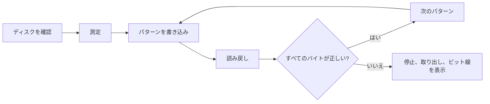

<div align="center">

<h1>kiyome</h1>

<strong>フロッピー、Zipディスク、USBメモリ、ハードディスクを検証付きの5つのパターンで消去し、故障しているビット線を示します。</strong>

[English](README.md) | 日本語 | [简体中文](README.zh-Hans.md) | [繁體中文 (香港)](README.zh-HK.md)

[](https://github.com/gufranco/kiyome/actions/workflows/ci.yml)
[](https://github.com/gufranco/kiyome/releases)
[](LICENSE)
[](#portability)

<p align="center">
  <a href="#quick-start"><strong>クイックスタート</strong></a> |
  <a href="#how-it-works">仕組み</a> |
  <a href="#development">開発</a>
</p>

</div>

コマンドは1つ、テストは9件、シェルのモジュールは9個で、POSIXシステム以外に実行時の依存はありません。`kiyome`は日本語の「清め」です。姉妹ツールの[kakikomi](https://github.com/gufranco/kakikomi)はディスクイメージを書き込みます。

---

```console
$ kiyome /dev/disk4
Device: /dev/disk4
Device reports itself as: SANDISK ULTRA
This will ERASE all data on /dev/disk4. Continue? (y/N): y
Measuring /dev/disk4 before wiping it, so every limit comes from this disk.
Pass 1 of 1
Writing per-chunk unique data over 4 chunks, timing every chunk
Verify per-chunk unique data completed
Verify 0xAA completed
Verify 0x55 completed
Verify 0xFF completed
Verify 0x00 completed
Device ejected successfully
```

<a id="quick-start"></a>

## クイックスタート

### 前提条件

| ツール | 用途 | インストール |
|:-----|:----|:--------|
| POSIX `sh`、`dd`、`cmp`、`od` | ツール本体 | macOSとLinuxにプリインストールされています。`bash`は不要です |
| `openssl` | チャンクごとに異なるパターン | プリインストールされています |
| `newfs_msdos`、または`sfdisk`と`mkfs.fat` | macOSまたはLinuxでの`CREATE=y` | macOSにはプリインストール済み。Linuxでは`apt install fdisk dosfstools` |
| `mkfs.exfat` | Linuxで32GiBを超えるディスクへの`CREATE=y` | `apt install exfatprogs` |

### インストール

```bash
brew install gufranco/tap/kiyome
```

ソースからもインストールできます。

```bash
git clone https://github.com/gufranco/kiyome.git
cd kiyome
make install
```

`make install`はツールを`~/.local`の下にコピーし、`kiyome`を`~/.local/bin`に置きます。場所は`PREFIX`で変えられます。

### 確認

```console
$ kiyome doctor
```

## 使い方

| コマンド | 用途 |
|:--------|:--------|
| `kiyome <device\|mount_point>` | そのディスクを検証付きの5つのパターンで上書きし、取り出します |
| 引数なしの`kiyome` | ターミナルで実行すると、ディスクとパスの回数を尋ねます |
| `kiyome doctor` | kiyomeが必要とするツールと、インストール状況を一覧表示します |
| `kiyome version`、`kiyome help` | バージョンまたは使い方の全文を表示します |

| 変数 | 効果 |
|:---------|:-------|
| `PASSES=N` | 5つのパターンをN回繰り返します。既定は1回です |
| `CREATE=y` | 空のディスクではなく、新しいFAT32またはexFATのファイルシステムを残します |
| `ALLOW_INTERNAL=y` | 内蔵ディスクを許可します。動作中のシステムがあるディスクは常に拒否されます |

<a id="how-it-works"></a>

## 仕組み

1回のパスで5つのパターンを書き込み、それぞれを読み戻してから次へ進みます。チャンクごとに異なるAES-CTRのデータ、続いて`0xAA`、`0x55`、`0xFF`、`0x00`です。固有のデータは、キャッシュから応答するディスクや、2つのアドレスを同じ場所に割り当てるディスクを見つけます。4つの固定パターンは、すべてのビットを0と1の両方に保ちます。

誤ったバイトは関係するビット線とともに報告されます。常に同じ1本が誤るなら、ケーブル、アダプター、ドライブのデータ線の固着です。散らばった誤りは媒体の劣化を示します。



kiyomeはまずディスク自体の速度を測り、その値から各転送の期限を決めます。不一致、停止、デバイスの消失があると、ただちに止めてディスクを取り出します。

| ドライブ | 扱い |
|:------|:----------|
| Zip、Jaz、PocketZip | 期限を短くし、再試行しません。停止はヘッドのずれとみなします。ずれたヘッドは次に入れたカートリッジを傷めます |
| フロッピー、SuperDisk | 再試行しません。ソフトウェアで取り出せないドライブなので、ディスクを抜くまで待ちます |
| その他 | チャンクごとに3回試してから止めます |

動作中のシステムがあるディスクは常に拒否され、マウントされたボリュームは書き込む前にアンマウントされます。

<a id="portability"></a>

## 移植性

すべてPOSIX `sh`で書かれ、ShellCheckの`-o all`で指摘ゼロ、無効化したチェックもありません。テストはmacOSの`/bin/sh`、`dash`、`bash`、`bash --posix`、`zsh`と、特権コンテナ内のUbuntuの同じシェルで実行します。

<a id="development"></a>

## 開発

| コマンド | 説明 |
|:--------|:------------|
| `make lint` | すべてのスクリプトにShellCheckを実行し、関数が二重に定義されていないことを確認します |
| `make test` | システムの`sh`で9件の`bats`テスト |
| `make test-all` | インストール済みのすべてのシェルで同じテスト |
| `make test-linux` | Macから、特権付きUbuntuコンテナで同じテスト |
| `make coverage` | このMacと同じコンテナでbashcovによる行カバレッジを測定して統合します。CIは100%を必須にします |

テストは`hdiutil`や`losetup`でファイルを使ったディスクを接続し、実際に消去します。CIはUbuntuとmacOSで実行します。`main`へのpushごとにsemantic-releaseが動き、`feat`か`fix`のコミットがあればリリースを公開し、[`lib/core.sh`](lib/core.sh)の`KIYOME_VERSION`とCHANGELOGを更新して、Homebrewのformulaも更新します。

## ライセンス

[MIT](LICENSE)
