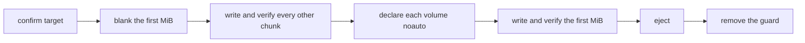

<div align="center">

<h1>kakikomi</h1>

<strong>Write disk images to floppies, Zip disks, USB sticks and hard disks, verified chunk by chunk, without letting the system mount them.</strong>

English | [日本語](README.ja.md) | [简体中文](README.zh-Hans.md) | [繁體中文 (香港)](README.zh-HK.md)

[](https://github.com/gufranco/kakikomi/actions/workflows/ci.yml)
[](https://github.com/gufranco/kakikomi/releases)
[](LICENSE)
[](#portability)

<p align="center">
  <a href="#quick-start"><strong>Quick start</strong></a> |
  <a href="#never-mounted">Never mounted</a> |
  <a href="#kiyome">kiyome</a> |
  <a href="#development">Development</a>
</p>

</div>

Two commands, 40 tests, 13 shell modules, and no runtime dependency beyond a POSIX system. `kakikomi` is 書き込み, Japanese for writing data to a disk; `kiyome` is 清め, purification, and wipes one clean.

---

```console
$ kakikomi debian.img.xz /dev/disk4
Image:  debian.img.xz
        xz, 1.4 GiB (1501560832 bytes)
Target: /dev/disk4, 14.9 GiB, SANDISK ULTRA
Type disk4 to write, or anything else to stop: disk4
Blanking the first 1.0 MiB so nothing on /dev/disk4 is mountable until the very end.
Told macOS not to mount the 2 volume(s) in this image.
Writing the first 1.0 MiB last.
Wrote and verified every chunk of the image.
Validated: /dev/disk4 matches the image, SHA-256 9f86d081884c7d65...
Ejected. /dev/disk4 is safe to remove.
```

<a id="quick-start"></a>

## Quick start

### Prerequisites

| Tool | Why | Install |
|:-----|:----|:--------|
| POSIX `sh`, `dd`, `cmp`, `od` | The tools themselves | Preinstalled on macOS and Linux. `bash` is not required |
| `openssl` | kiyome's per-chunk random pattern | Preinstalled |
| `gzip`, `xz`, `zstd`, `bzip2` | Compressed images | Only for the formats you write |
| `bsdtar` or `7z` | `.zip` images and Windows ISOs | `libarchive-tools` or `p7zip-full` on Linux |
| `qemu-img` | `.vhd`, `.vhdx`, `.vmdk`, `.qcow2` | `brew install qemu` or `apt install qemu-utils` |
| `mtools`, `wimlib` | Windows ISOs and `kakikomi format` | Installed with the Homebrew formula; `apt install mtools wimtools` |

### Install

```bash
brew install gufranco/tap/kakikomi
```

Or from source:

```bash
git clone https://github.com/gufranco/kakikomi.git
cd kakikomi
make install
```

`make install` copies the tools under `~/.local` and puts `kakikomi` and `kiyome` in `~/.local/bin`; set `PREFIX` to change that.

### Verify

```console
$ kakikomi --version
kakikomi 1.0.0
```

## Usage

| Command | Purpose |
|:--------|:--------|
| `kakikomi <image\|url\|device> [target...]` | Write an image to one or more disks. With no target, lists the removable disks to pick from |
| `kakikomi <windows.iso> <target>` | Lay a Windows installer ISO out as a UEFI-bootable FAT32 stick |
| `kakikomi format <target> [fat32\|exfat\|fat\|floppy] [LABEL]` | Quick format: write only the new filesystem's structures |
| `kakikomi --release` | Remove the mount guards a run left behind |
| `kiyome <target>` | Overwrite a disk with five verified patterns |
| `kakikomi` or `kiyome` with no arguments | Ask for each value in turn when run in a terminal |
| `kakikomi doctor`, `kiyome doctor` | List the tools each one needs and whether they are installed |
| `kakikomi version`, `kakikomi help` | Print the version or the full usage page; kiyome takes the same |

| Source | How it is read |
|:-------|:---------------|
| `.img`, `.iso`, `.bin`, `.raw`, `.dsk`, `.ima` | Directly |
| `.gz`, `.xz`, `.zst`, `.bz2` | Streamed, never extracted to disk |
| `.zip` holding one image | Streamed with `bsdtar` |
| `.dmg`, `.vhd`, `.vhdx`, `.vmdk`, `.qcow2` | Converted to raw first, after a free-space check |
| `http://` or `https://` URL | Downloaded with resume, then read as a file |
| `/dev/...` | Cloned from that drive, which is also kept unmounted |

| Variable | Effect |
|:---------|:-------|
| `VERIFY=n` | Skip the whole-disk SHA-256 comparison at the end. Asked when unset |
| `DELETE=y` | Move the image to the Trash once every disk validated. Ignored when nothing was read back |
| `AGAIN=y` | Write the same image to the next disk you insert |
| `REINSERT=y` | After ejecting, wait for the disk to come back and compare it again |
| `ZERO_TAIL=y` | Blank the space past the image on a larger disk |
| `SHA256=<hash>` | Stop unless the image matches. A sibling `.sha256` or `SHA256SUMS` file is read automatically |
| `ALLOW_INTERNAL=y` | Allow an internal disk. The disk holding the running system is always refused |
| `KEEP_GUARD=y` | Keep the fstab guard after the run, so this Mac never mounts that disk |
| `MODE=raw` | Write a Windows ISO byte for byte instead of laying it out as FAT32 |

```bash
kakikomi debian.img.xz /dev/disk4 /dev/disk5     # two sticks at once
kakikomi https://example.org/os.img.gz            # pick the target from a list
kakikomi /dev/disk4 /dev/disk5                    # clone disk4 onto disk5
AGAIN=y kakikomi game.ima /dev/disk6              # a batch of floppies
kakikomi format /dev/disk4 exfat MEDIA
```

<a id="never-mounted"></a>

## Never mounted

macOS writes `.fseventsd`, `.Spotlight-V100` and `._` files onto any FAT volume it mounts, even for a moment, so a disk written for a retro machine comes back changed. kakikomi keeps the system out:



| Step | Detail |
|:-----|:-------|
| Nothing mountable until the end | With the first MiB blank there is no partition table or boot sector, so neither DiskArbitration nor udisks finds a volume |
| Declared before it appears | macOS: each volume's UUID goes into `/etc/fstab` as `noauto`, read from a header-only copy attached with `-nomount`. Linux: a `UDISKS_IGNORE` udev rule for the device |
| Watched | A mount seen during the run fails it and names the files the system created |
| Proven | `REINSERT=y` reads the whole disk back after you unplug and replug it |

A run stopped halfway leaves the first MiB blank, so the half-written disk is not mountable either.

## Stops at the first problem

Every chunk is written, read back, and compared before the next one. kakikomi first times the disk on itself, then gives each transfer a deadline from that measurement. A mismatch, a stall or a vanished device stops that disk, ejects it, and prints which bit lines were wrong.

| Drive | Treatment |
|:------|:----------|
| Zip, Jaz, PocketZip | Tighter deadlines and no retries; a stall is treated as a mistracking head, which damages the next cartridge it meets |
| Floppy, SuperDisk | No retries, and the run waits for you to remove the disk since these drives have no software eject |
| Everything else | Three attempts per chunk, then a stop |

With several targets, each disk is written by its own worker, and a fault on one does not stop the others.

## Windows installers

A Windows ISO written byte for byte does not boot from USB. kakikomi detects one and builds an MBR disk with a single FAT32 partition holding every file, splitting an `install.wim` over 4 GiB with `wimlib`. The files are copied with `mtools`, so the target is never mounted, and every file is read back and compared before the volume is written. The result boots on UEFI machines.

<a id="kiyome"></a>

## kiyome

```console
$ kiyome /dev/disk4
This will ERASE all data on /dev/disk4. Continue? (y/N): y
Pass 1 of 1
Writing per-chunk unique data over 4 chunks, timing every chunk
Verify per-chunk unique data completed
Verify 0xAA completed
Verify 0x55 completed
Verify 0xFF completed
Verify 0x00 completed
Device ejected successfully
```

Each pass writes and reads back five patterns: AES-CTR data unique to every chunk, then `0xAA`, `0x55`, `0xFF` and `0x00`. A wrong byte is reported with the bit lines involved, which tells a stuck data line in a cable or adapter apart from worn media. `PASSES=N` repeats it and `CREATE=y` leaves a fresh FAT or exFAT filesystem behind.

<a id="portability"></a>

## Portability

Everything is POSIX `sh` with ShellCheck `-o all` at zero findings and no disabled checks. The suites run on macOS under `/bin/sh`, `dash`, `bash`, `bash --posix` and `zsh`, and on Ubuntu under the same shells in a privileged container.

<a id="development"></a>

## Development

| Command | Description |
|:--------|:------------|
| `make lint` | ShellCheck on every script |
| `make test` | The 40 `bats` tests under the system `sh` |
| `make test-all` | The same tests under every installed shell |
| `make test-linux` | The same tests in a privileged Ubuntu container, from a Mac |
| `make coverage` | bashcov line coverage on this Mac and in that container, merged, with a 100% gate CI enforces |

The tests attach file-backed disks with `hdiutil` or `losetup`, write to them for real, and inject I/O errors with `dmsetup` on Linux. CI runs them on Ubuntu and macOS. Every push to `main` runs semantic-release: a `feat` or `fix` commit publishes a release, updates `KAKIKOMI_VERSION` in [`lib/core.sh`](lib/core.sh) and the CHANGELOG, and bumps the Homebrew formula.

## License

[MIT](LICENSE)
