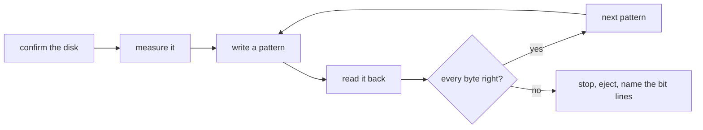

<div align="center">

<h1>kiyome</h1>

<strong>Wipe floppies, Zip disks, USB sticks and hard disks with five verified patterns, and name the bit line that is failing.</strong>

English | [日本語](README.ja.md) | [简体中文](README.zh-Hans.md) | [繁體中文 (香港)](README.zh-HK.md)

[](https://github.com/gufranco/kiyome/actions/workflows/ci.yml)
[](https://github.com/gufranco/kiyome/releases)
[](LICENSE)
[](#portability)

<p align="center">
  <a href="#quick-start"><strong>Quick start</strong></a> |
  <a href="#how-it-works">How it works</a> |
  <a href="#development">Development</a>
</p>

</div>

One command, 130 tests, 9 shell modules, and no runtime dependency beyond a POSIX system. `kiyome` is 清め, Japanese for purification. Its companion [kakikomi](https://github.com/gufranco/kakikomi) writes disk images.

---

```console
$ kiyome /dev/disk4
Device: /dev/disk4
Device reports itself as: SANDISK ULTRA
This will ERASE all data on /dev/disk4. Continue? (y/N): y
Measuring /dev/disk4 before wiping it, so every limit comes from this disk.
Pass 1 of 1
Writing per-chunk unique data over 4 chunks, timing every chunk
Verify per-chunk unique data completed
Verify 0xAA completed
Verify 0x55 completed
Verify 0xFF completed
Verify 0x00 completed
Device ejected successfully
```

<a id="quick-start"></a>

## Quick start

### Prerequisites

| Tool | Why | Install |
|:-----|:----|:--------|
| POSIX `sh`, `dd`, `cmp`, `od` | The tool itself | Preinstalled on macOS and Linux. `bash` is not required |
| `openssl` | The per-chunk unique pattern | Preinstalled |
| `newfs_msdos`, or `sfdisk` and `mkfs.fat` | `CREATE=y` on macOS, or on Linux | Preinstalled on macOS; `apt install fdisk dosfstools` |
| `mkfs.exfat` | `CREATE=y` on disks over 32 GiB on Linux | `apt install exfatprogs` |

### Install

```bash
brew install gufranco/tap/kiyome
```

Or from source:

```bash
git clone https://github.com/gufranco/kiyome.git
cd kiyome
make install
```

`make install` copies the tool under `~/.local` and puts `kiyome` in `~/.local/bin`; set `PREFIX` to change that.

### Verify

```console
$ kiyome doctor
```

## Usage

| Command | Purpose |
|:--------|:--------|
| `kiyome <device\|mount_point>` | Overwrite that disk with five verified patterns, then eject it |
| `kiyome` with no arguments | Ask for the disk and the number of passes when run in a terminal |
| `kiyome doctor` | List the tools kiyome needs and whether they are installed |
| `kiyome version`, `kiyome help` | Print the version or the full usage page |

| Variable | Effect |
|:---------|:-------|
| `PASSES=N` | Repeat the five patterns N times. 1 by default |
| `CREATE=y` | Leave a fresh FAT32 or exFAT filesystem behind instead of a blank disk |
| `ALLOW_INTERNAL=y` | Allow an internal disk. The disk holding the running system is always refused |

<a id="how-it-works"></a>

## How it works

Each pass writes five patterns and reads every one back before the next: AES-CTR data unique to every chunk, then `0xAA`, `0x55`, `0xFF` and `0x00`. The unique data catches a disk that answers from a cache or maps two addresses to the same place. The four fixed patterns hold every bit at 0 and at 1.

A wrong byte is reported with the bit lines involved. One line always wrong points at a stuck data line in a cable, adapter or drive; scattered errors point at worn media.



kiyome first times the disk on itself, then gives each transfer a deadline from that measurement. A mismatch, a stall or a vanished device stops the run at once and ejects the disk.

| Drive | Treatment |
|:------|:----------|
| Zip, Jaz, PocketZip | Tighter deadlines and no retries; a stall is treated as a mistracking head, which damages the next cartridge it meets |
| Floppy, SuperDisk | No retries, and the run waits for you to remove the disk since these drives have no software eject |
| Everything else | Three attempts per chunk, then a stop |

The disk holding the running system is always refused, and a mounted volume is unmounted before anything is written.

<a id="portability"></a>

## Portability

Everything is POSIX `sh` with ShellCheck `-o all` at zero findings and no disabled checks. The suites run on macOS under `/bin/sh`, `dash`, `bash`, `bash --posix` and `zsh`, and on Ubuntu under the same shells in a privileged container.

<a id="development"></a>

## Development

| Command | Description |
|:--------|:------------|
| `make lint` | ShellCheck on every script, and a check that no function is defined twice |
| `make test` | The 130 `bats` tests under the system `sh` |
| `make test-all` | The same tests under every installed shell |
| `make test-linux` | The same tests in a privileged Ubuntu container, from a Mac |
| `make coverage` | bashcov line coverage on this Mac and in that container, merged, with a 100% gate CI enforces |

The tests attach file-backed disks with `hdiutil` or `losetup` and wipe them for real. CI runs them on Ubuntu and macOS. Every push to `main` runs semantic-release: a `feat` or `fix` commit publishes a release, updates `KIYOME_VERSION` in [`lib/core.sh`](lib/core.sh) and the CHANGELOG, and bumps the Homebrew formula.

## License

[MIT](LICENSE)
