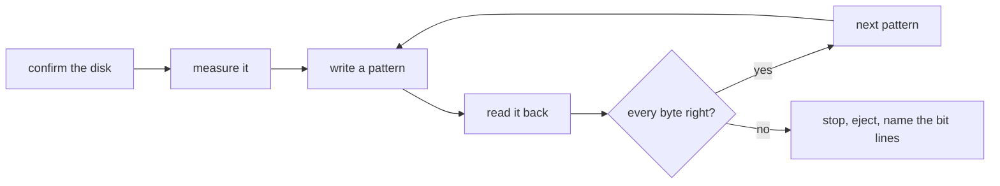

<div align="center">

<h1>kiyome</h1>

<strong>Wipe floppies, Zip disks, USB sticks and hard disks with five verified patterns, and name the bit line that is failing.</strong>

English | [日本語](README.ja.md) | [简体中文](README.zh-Hans.md) | [繁體中文 (香港)](README.zh-HK.md)

[](https://github.com/gufranco/kiyome/actions/workflows/ci.yml)
[](https://github.com/gufranco/kiyome/releases/latest)
[](LICENSE)

<p align="center">
  <a href="#quick-start"><strong>Quick start</strong></a> |
  <a href="#how-it-works">How it works</a> |
  <a href="#development">Development</a>
</p>

</div>

One command, 166 tests, 9 shell modules, and no runtime dependency beyond a POSIX system. `kiyome` is 清め, Japanese for purification. Its companion [kakikomi](https://github.com/gufranco/kakikomi) writes disk images.

---

```console
$ kiyome /dev/disk6

Device: /dev/disk6, 64.0 MiB, DISK IMAGE
        Everything on it is erased, including:
          +67.1 MB disk6
Plan:   1 pass of unique data, 0xAA, 0x55, 0xFF and 0x00, each read back
        then eject

Type disk6 to erase, or anything else to stop: disk6
Unmounting /dev/disk6...
Disk unmounted
Measuring /dev/disk6 before wiping it, so every limit comes from this disk.
Measured read: 222666 KiB/s, 26ms to reach a sector, allowing 3x that.
Measured write: 27028 KiB/s, 27ms to reach a sector, allowing 3x that.
Pass 1 of 1, writing per-chunk unique data 100%  438.4 MiB/s  0m00s left
Pass 1 of 1, verifying per-chunk unique data 100%  237.9 MiB/s  0m00s left
Pass 1 of 1, writing 0xAA 100%  888.9 MiB/s  0m00s left
Pass 1 of 1, verifying 0xAA 100%  400.0 MiB/s  0m00s left
Pass 1 of 1, writing 0x55 100%  941.2 MiB/s  0m00s left
Pass 1 of 1, verifying 0x55 100%  240.6 MiB/s  0m00s left
Pass 1 of 1, writing 0xFF 100%  888.9 MiB/s  0m00s left
Pass 1 of 1, verifying 0xFF 100%  390.2 MiB/s  0m00s left
Pass 1 of 1, writing 0x00 100%  711.1 MiB/s  0m00s left
Pass 1 of 1, verifying 0x00 100%  280.7 MiB/s  0m00s left
Wiped /dev/disk6: every byte of every pattern read back as written.
Ejecting /dev/disk6...
Ejected. /dev/disk6 is safe to remove.
```

<a id="quick-start"></a>

## Quick start

### Prerequisites

| Tool | Why | Install |
|:-----|:----|:--------|
| POSIX `sh`, `dd`, `cmp`, `od` | The tool itself | Preinstalled on macOS and Linux. `bash` is not required |
| `openssl` | The per-chunk unique pattern | Preinstalled |
| `newfs_msdos`, or `sfdisk` and `mkfs.fat` | `--create` on macOS, or on Linux | Preinstalled on macOS; `apt install fdisk dosfstools` |
| `mkfs.exfat` | `--create` on disks over 32 GiB on Linux | `apt install exfatprogs` |

### Install

```bash
brew install gufranco/tap/kiyome
```

Or from source:

```bash
git clone https://github.com/gufranco/kiyome.git
cd kiyome
make install
```

`make install` copies the tool, its man page and its bash, zsh and fish completions under `~/.local`, and puts `kiyome` in `~/.local/bin`; set `PREFIX` to change that. The Homebrew formula installs the same files.

### Verify

```console
$ kiyome doctor
dd                 ok       /bin/dd, bsd
cmp                ok       /usr/bin/cmp, bsd
od                 ok       /usr/bin/od, bsd
awk                ok       /usr/bin/awk, bsd 20200816
sed                ok       /usr/bin/sed, bsd
sudo               ok       /usr/bin/sudo
sha256sum|shasum   ok       /sbin/sha256sum, bsd 1.0
diskutil           ok       /usr/sbin/diskutil
hdiutil            ok       /usr/bin/hdiutil
openssl            ok       /usr/bin/openssl
```

## Usage

| Command | Purpose |
|:--------|:--------|
| `kiyome [options] <device\|mount_point>` | Overwrite that disk with five verified patterns, then eject it |
| `kiyome` with no arguments | Ask for the disk and the number of passes when run in a terminal |
| `kiyome doctor` | List the tools kiyome needs and whether they are installed |
| `kiyome version`, `kiyome help` | Print the version or the full usage page |

| Option | Effect |
|:-------|:-------|
| `--passes N` | Repeat the five patterns N times. 1 by default |
| `--create` | Leave a fresh FAT32 or exFAT filesystem behind instead of a blank disk |
| `--allow-internal` | Allow an internal disk. The disk holding the running system is always refused |
| `--json` | Print the result as one JSON object, for scripts |

`--passes=3` works too, and `--` ends the options. The environment variables `KIYOME_PASSES=N`, `KIYOME_CREATE=y`, `KIYOME_ALLOW_INTERNAL=y` and `KIYOME_JSON=y` set the same options; an option on the command line wins.

```bash
kiyome /dev/disk4                 # one pass, then eject
kiyome --passes 3 /dev/sdb        # three passes
kiyome /Volumes/USB               # a mounted volume stands for its whole disk
kiyome --create /Volumes/USB      # leave a FAT32 or exFAT filesystem behind
```

A disk is named by its device, such as `/dev/disk4`, or by any volume mounted from it, such as `/Volumes/USB`; kiyome works out the whole disk behind the volume and wipes all of it.

kiyome follows the shared command-line contract of its family, described in [FAMILY.md](FAMILY.md).

<a id="how-it-works"></a>

## How it works

Each pass writes five patterns and reads every one back before the next: AES-CTR data unique to every chunk, then `0xAA`, `0x55`, `0xFF` and `0x00`. The unique data catches a disk that answers from a cache or maps two addresses to the same place. The four fixed patterns hold every bit at 0 and at 1.

A wrong byte is reported with the bit lines involved. One line always wrong points at a stuck data line in a cable, adapter or drive; scattered errors point at worn media.



kiyome first times the disk on itself, then gives each transfer a deadline from that measurement. A mismatch, a stall or a vanished device stops the run at once and ejects the disk.

| Drive | Treatment |
|:------|:----------|
| Zip, Jaz, PocketZip | Tighter deadlines and no retries; a stall is treated as a mistracking head, which damages the next cartridge it meets |
| Floppy, SuperDisk | No retries, and the run waits for you to remove the disk since these drives have no software eject |
| Everything else | Three attempts per chunk, then a stop |

The disk holding the running system is always refused, and a mounted volume is unmounted before anything is written.

<a id="portability"></a>

## Portability

Everything is POSIX `sh` with ShellCheck `-o all` at zero findings and no disabled checks. The suites run on macOS under `/bin/sh` and `dash`, the system's bash 3.2 and zsh, and Homebrew's current bash and zsh, and on Ubuntu under `dash`, `bash`, `bash --posix` and `zsh` in a privileged container.

Every run works on the five toolsets in common use: Linux with GNU or uutils coreutils, and macOS with the tools it ships, Homebrew's newer builds of them, or Homebrew's uutils tools. Every tool macOS ships that Homebrew also builds newer, from bash and zsh to openssl and perl, is tested in both builds. CI runs the whole suite on each, and `kiyome doctor` names the flavor and version of every core tool, such as `gnu 9.7`, `uutils 0.12.0` or `bsd 20200816`, so a bug report says which tools ran.

<a id="development"></a>

## Development

| Command | Description |
|:--------|:------------|
| `make fmt` | Formats every script with shfmt |
| `make lint` | shfmt, ShellCheck on every script, test and completion, and mandoc on the man page |
| `make test` | The `bats` tests under the system `sh` |
| `make test-all` | The same tests under every shell, both builds of bash and zsh included on macOS |
| `make test-linux` | The same tests in an Ubuntu container |
| `make coverage` | bashcov line coverage on this Mac and in the Ubuntu container, merged, with the 100% gate CI enforces |

The tests attach file-backed disks with `hdiutil` or `losetup` and wipe them for real. CI runs them on Ubuntu and macOS. Once CI passes on a push to `main`, semantic-release runs: a `feat` or `fix` commit publishes a release, updates `KIYOME_VERSION` in [`lib/core.sh`](lib/core.sh) and the CHANGELOG, and bumps the Homebrew formula.

## License

[MIT](LICENSE)
