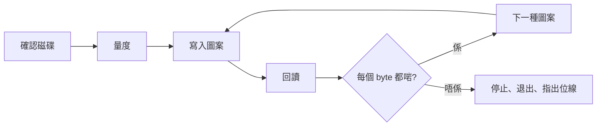

<div align="center">

<h1>kiyome</h1>

<strong>用五種經過校驗嘅圖案抹走軟碟、Zip 碟、USB 手指同硬碟，並指出出事嘅位線。</strong>

[English](README.md) | [日本語](README.ja.md) | [简体中文](README.zh-Hans.md) | 繁體中文 (香港)

[](https://github.com/gufranco/kiyome/actions/workflows/ci.yml)
[](https://github.com/gufranco/kiyome/releases)
[](LICENSE)
[](#portability)

<p align="center">
  <a href="#quick-start"><strong>快速開始</strong></a> |
  <a href="#how-it-works">運作原理</a> |
  <a href="#development">開發</a>
</p>

</div>

一個指令，131 個測試，9 個 shell 模組，除咗 POSIX 系統之外冇任何執行時依賴。`kiyome` 係日文「清め」，即係淨化。佢嘅姊妹工具 [kakikomi](https://github.com/gufranco/kakikomi) 用嚟寫入磁碟映像。

---

```console
$ kiyome /dev/disk4
Device: /dev/disk4
Device reports itself as: SANDISK ULTRA
This will ERASE all data on /dev/disk4. Continue? (y/N): y
Measuring /dev/disk4 before wiping it, so every limit comes from this disk.
Pass 1 of 1
Writing per-chunk unique data over 4 chunks, timing every chunk
Verify per-chunk unique data completed
Verify 0xAA completed
Verify 0x55 completed
Verify 0xFF completed
Verify 0x00 completed
Device ejected successfully
```

<a id="quick-start"></a>

## 快速開始

### 前置條件

| 工具 | 用途 | 安裝 |
|:-----|:----|:--------|
| POSIX `sh`、`dd`、`cmp`、`od` | 工具本身 | macOS 同 Linux 已預裝，唔需要 `bash` |
| `openssl` | 每塊都唔同嘅圖案 | 已預裝 |
| `newfs_msdos`，或者 `sfdisk` 同 `mkfs.fat` | macOS 或 Linux 上嘅 `CREATE=y` | macOS 已預裝；Linux 上係 `apt install fdisk dosfstools` |
| `mkfs.exfat` | Linux 上對超過 32 GiB 嘅磁碟用 `CREATE=y` | `apt install exfatprogs` |

### 安裝

```bash
brew install gufranco/tap/kiyome
```

亦可以由原始碼安裝：

```bash
git clone https://github.com/gufranco/kiyome.git
cd kiyome
make install
```

`make install` 會將工具複製到 `~/.local` 之下，再將 `kiyome` 放入 `~/.local/bin`；設定 `PREFIX` 可以改位置。

### 驗證

```console
$ kiyome doctor
```

## 用法

| 指令 | 用途 |
|:--------|:--------|
| `kiyome <device\|mount_point>` | 用五種經過校驗嘅圖案覆寫嗰隻磁碟，然後退出 |
| 唔帶參數嘅 `kiyome` | 喺終端機執行時，問你邊隻磁碟同埋做幾輪 |
| `kiyome doctor` | 列出 kiyome 需要嘅工具同埋有冇安裝 |
| `kiyome version`、`kiyome help` | 顯示版本或完整用法 |

| 變數 | 效果 |
|:---------|:-------|
| `PASSES=N` | 將五種圖案重複 N 次，預設 1 次 |
| `CREATE=y` | 最後留低一個全新嘅 FAT32 或 exFAT 檔案系統，而唔係空白磁碟 |
| `ALLOW_INTERNAL=y` | 允許內置磁碟。正在運行嘅系統所在嘅磁碟一定會被拒絕 |

<a id="how-it-works"></a>

## 運作原理

每一輪寫入五種圖案，每種都回讀之後先去下一種：每塊都唔同嘅 AES-CTR 資料，然後係 `0xAA`、`0x55`、`0xFF` 同 `0x00`。每塊唔同嘅資料可以搵出由快取回應、或者將兩個位址對應到同一個位置嘅磁碟。四種固定圖案令每一位都分別處於 0 同 1。

錯誤嘅 byte 會連同相關位線一齊報告。成日都係同一條位線出錯，代表線材、轉接器或磁碟機入面有卡住嘅資料線；錯誤分散就代表媒體老化。



kiyome 會先測量磁碟本身嘅速度，再根據結果為每次傳輸設定期限。唔吻合、停頓或者裝置消失，都會即刻停止並退出磁碟。

| 磁碟機 | 處理方式 |
|:------|:----------|
| Zip、Jaz、PocketZip | 期限更嚴而且唔重試；停頓會當成磁頭偏離，偏離咗嘅磁頭會整壞佢遇到嘅下一隻碟 |
| 軟碟、SuperDisk | 唔重試，並等你取出磁碟，因為呢啲磁碟機冇得用軟件退出 |
| 其他 | 每塊試三次，然後停止 |

正在運行嘅系統所在嘅磁碟一定會被拒絕，已掛載嘅卷會喺寫入之前卸載。

<a id="portability"></a>

## 可攜性

所有程式碼都係 POSIX `sh`，ShellCheck `-o all` 零發現，冇停用任何檢查。測試喺 macOS 嘅 `/bin/sh`、`dash`、`bash`、`bash --posix` 同 `zsh` 之下運行，亦喺特權容器入面嘅 Ubuntu 用相同嘅 shell 運行。

<a id="development"></a>

## 開發

| 指令 | 說明 |
|:--------|:------------|
| `make lint` | 對每個腳本執行 ShellCheck，並檢查冇函數被重複定義 |
| `make test` | 喺系統 `sh` 之下執行 131 個 `bats` 測試 |
| `make test-all` | 喺每個已安裝嘅 shell 之下執行相同測試 |
| `make test-linux` | 由 Mac 喺特權 Ubuntu 容器入面執行相同測試 |
| `make coverage` | 喺呢部 Mac 同同一個容器用 bashcov 量度行覆蓋率並合併，CI 要求 100% |

測試用 `hdiutil` 或 `losetup` 掛接以檔案為後端嘅磁碟，並真實抹走。CI 喺 Ubuntu 同 macOS 上運行。每次推送到 `main` 都會執行 semantic-release：有 `feat` 或 `fix` commit 時就會發佈 release，更新 [`lib/core.sh`](lib/core.sh) 入面嘅 `KIYOME_VERSION` 同 CHANGELOG，並更新 Homebrew formula。

## 授權

[MIT](LICENSE)
