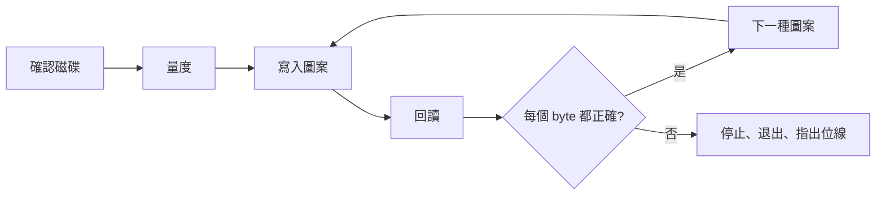

<div align="center">

<h1>kiyome</h1>

<strong>用五種經過校驗的圖案抹除軟碟、Zip 碟、USB 手指和硬碟，並指出出錯的位線。</strong>

[English](README.md) | [日本語](README.ja.md) | [简体中文](README.zh-Hans.md) | 繁體中文 (香港)

[](https://github.com/gufranco/kiyome/actions/workflows/ci.yml)
[](https://github.com/gufranco/kiyome/releases)
[](LICENSE)
[](#portability)

<p align="center">
  <a href="#quick-start"><strong>快速開始</strong></a> |
  <a href="#how-it-works">運作原理</a> |
  <a href="#development">開發</a>
</p>

</div>

一條指令，166 個測試，9 個 shell 模組，除了 POSIX 系統之外沒有任何執行時依賴。`kiyome` 是日文「清め」，意思是淨化。姊妹工具 [kakikomi](https://github.com/gufranco/kakikomi) 負責寫入磁碟映像。

---

```console
$ kiyome /dev/disk6

Device: /dev/disk6, 64.0 MiB, DISK IMAGE
        Everything on it is erased, including:
          +67.1 MB disk6
Plan:   1 pass of unique data, 0xAA, 0x55, 0xFF and 0x00, each read back
        then eject

Type disk6 to erase, or anything else to stop: disk6
Unmounting /dev/disk6...
Disk unmounted
Measuring /dev/disk6 before wiping it, so every limit comes from this disk.
Measured read: 222666 KiB/s, 26ms to reach a sector, allowing 3x that.
Measured write: 27028 KiB/s, 27ms to reach a sector, allowing 3x that.
Pass 1 of 1, writing per-chunk unique data 100%  438.4 MiB/s  0m00s left
Pass 1 of 1, verifying per-chunk unique data 100%  237.9 MiB/s  0m00s left
Pass 1 of 1, writing 0xAA 100%  888.9 MiB/s  0m00s left
Pass 1 of 1, verifying 0xAA 100%  400.0 MiB/s  0m00s left
Pass 1 of 1, writing 0x55 100%  941.2 MiB/s  0m00s left
Pass 1 of 1, verifying 0x55 100%  240.6 MiB/s  0m00s left
Pass 1 of 1, writing 0xFF 100%  888.9 MiB/s  0m00s left
Pass 1 of 1, verifying 0xFF 100%  390.2 MiB/s  0m00s left
Pass 1 of 1, writing 0x00 100%  711.1 MiB/s  0m00s left
Pass 1 of 1, verifying 0x00 100%  280.7 MiB/s  0m00s left
Wiped /dev/disk6: every byte of every pattern read back as written.
Ejecting /dev/disk6...
Ejected. /dev/disk6 is safe to remove.
```

<a id="quick-start"></a>

## 快速開始

### 先決條件

| 工具 | 用途 | 安裝 |
|:-----|:----|:--------|
| POSIX `sh`、`dd`、`cmp`、`od` | 工具本身 | macOS 和 Linux 已預裝，不需要 `bash` |
| `openssl` | 每塊都不同的圖案 | 已預裝 |
| `newfs_msdos`，或 `sfdisk` 和 `mkfs.fat` | macOS 或 Linux 上的 `--create` | macOS 已預裝；Linux 上為 `apt install fdisk dosfstools` |
| `mkfs.exfat` | Linux 上對超過 32 GiB 的磁碟使用 `--create` | `apt install exfatprogs` |

### 安裝

```bash
brew install gufranco/tap/kiyome
```

或從原始碼安裝：

```bash
git clone https://github.com/gufranco/kiyome.git
cd kiyome
make install
```

`make install` 把工具、man 說明頁以及 bash、zsh、fish 自動補全複製到 `~/.local` 之下，並把 `kiyome` 放進 `~/.local/bin`；設定 `PREFIX` 可以改變位置。Homebrew formula 安裝的是相同的檔案。

### 驗證

```console
$ kiyome doctor
dd                 ok       /bin/dd, bsd
cmp                ok       /usr/bin/cmp, bsd
od                 ok       /usr/bin/od, bsd
awk                ok       /usr/bin/awk, bsd 20200816
sed                ok       /usr/bin/sed, bsd
sudo               ok       /usr/bin/sudo
sha256sum|shasum   ok       /sbin/sha256sum, bsd 1.0
diskutil           ok       /usr/sbin/diskutil
hdiutil            ok       /usr/bin/hdiutil
openssl            ok       /usr/bin/openssl
```

## 用法

| 指令 | 作用 |
|:--------|:--------|
| `kiyome [options] <device\|mount_point>` | 用五種經過校驗的圖案覆寫該磁碟，然後退出 |
| 不帶參數的 `kiyome` | 在終端機執行時，詢問磁碟和輪數 |
| `kiyome doctor` | 列出 kiyome 需要的工具及是否已安裝 |
| `kiyome version`、`kiyome help` | 顯示版本或完整用法 |

| 選項 | 效果 |
|:-------|:-------|
| `--passes N` | 把五種圖案重複 N 次，預設 1 次 |
| `--create` | 最後留下一個全新的 FAT32 或 exFAT 檔案系統，而不是空白磁碟 |
| `--allow-internal` | 允許內置磁碟。正在運行的系統所在的磁碟一定會被拒絕 |

也可以寫成 `--passes=3`，`--` 表示選項結束。環境變數 `KIYOME_PASSES=N`、`KIYOME_CREATE=y` 和 `KIYOME_ALLOW_INTERNAL=y` 設定的是同樣的選項，命令列上的選項優先。

```bash
kiyome /dev/disk4                 # 一輪，然後退出
kiyome --passes 3 /dev/sdb        # 三輪
kiyome /Volumes/USB               # 已掛載的卷代表它所在的整個磁碟
kiyome --create /Volumes/USB      # 最後留下 FAT32 或 exFAT 檔案系統
```

磁碟可以用裝置名稱指定，例如 `/dev/disk4`，也可以用它掛載出的任何卷指定，例如 `/Volumes/USB`；kiyome 會找出卷背後的整個磁碟，並抹除整個磁碟。

kiyome 遵循同系列工具共用的命令列約定，詳見 [FAMILY.md](FAMILY.md)。

<a id="how-it-works"></a>

## 運作原理

每一輪寫入五種圖案，每種都回讀之後才進行下一種：每塊都不同的 AES-CTR 資料，然後是 `0xAA`、`0x55`、`0xFF` 和 `0x00`。每塊不同的資料能找出由快取回應、或把兩個位址對應到同一位置的磁碟。四種固定圖案令每一位分別處於 0 和 1。

錯誤的 byte 會連同相關位線一起報告。總是同一條位線出錯，代表線材、轉接器或磁碟機內有卡住的資料線；錯誤分散則代表媒體老化。



kiyome 會先量度磁碟本身的速度，再根據結果為每次傳輸設定期限。不吻合、停頓或裝置消失，都會立即停止並退出磁碟。

| 磁碟機 | 處理方式 |
|:------|:----------|
| Zip、Jaz、PocketZip | 期限更嚴而且不重試；停頓會被視為磁頭偏離，偏離的磁頭會損壞它遇到的下一隻碟 |
| 軟碟、SuperDisk | 不重試，並等你取出磁碟，因為這些磁碟機無法用軟件退出 |
| 其他 | 每塊嘗試三次，然後停止 |

正在運行的系統所在的磁碟一定會被拒絕，已掛載的卷會在寫入之前卸載。

<a id="portability"></a>

## 可攜性

全部是 POSIX `sh`，ShellCheck `-o all` 零發現，沒有停用任何檢查。測試在 macOS 的 `/bin/sh` 和 `dash`、系統內置的 bash 3.2 和 zsh 以及 Homebrew 的最新 bash 和 zsh 下執行，亦在特權容器內的 Ubuntu 以 `dash`、`bash`、`bash --posix` 和 `zsh` 執行。

它能在五種常用工具集上執行：Linux 上的 GNU 或 uutils coreutils，以及 macOS 內置的工具、Homebrew 中較新的版本或 Homebrew 的 uutils 工具。macOS 內置而 Homebrew 有較新版本的工具，由 bash 和 zsh 到 openssl 和 perl，兩個版本都會測試。CI 在每種工具集上執行全部測試，`kiyome doctor` 會列出每個核心工具的類型和版本，例如 `gnu 9.7`、`uutils 0.12.0` 或 `bsd 20200816`，讓錯誤報告說明用的是哪些工具。

<a id="development"></a>

## 開發

| 指令 | 說明 |
|:--------|:------------|
| `make lint` | 對每個腳本和自動補全執行 ShellCheck，用 mandoc 檢查 man 說明頁，並檢查沒有函數被重複定義 |
| `make test` | 在系統 `sh` 下執行 166 個 `bats` 測試 |
| `make test-all` | 在每個已安裝的 shell 下執行相同測試 |
| `make test-linux` | 從 Mac 在特權 Ubuntu 容器內執行相同測試 |
| `make coverage` | 在這部 Mac 和同一個容器內用 bashcov 量度行覆蓋率並合併，CI 要求 100% |

測試用 `hdiutil` 或 `losetup` 掛接以檔案為後端的磁碟，並真實地抹除。CI 在 Ubuntu 和 macOS 上執行。每次推送到 `main` 都會執行 semantic-release：`feat` 或 `fix` commit 會發佈新版本，更新 [`lib/core.sh`](lib/core.sh) 內的 `KIYOME_VERSION` 和 CHANGELOG，並更新 Homebrew formula。

## 授權

[MIT](LICENSE)
