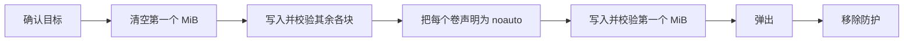

<div align="center">

<h1>kakikomi</h1>

<strong>把磁盘镜像写入软盘、Zip 盘、U 盘和硬盘，逐块校验，并且不让系统挂载它们。</strong>

[English](README.md) | [日本語](README.ja.md) | 简体中文 | [繁體中文 (香港)](README.zh-HK.md)

[](https://github.com/gufranco/kakikomi/actions/workflows/ci.yml)
[](https://github.com/gufranco/kakikomi/releases)
[](LICENSE)
[](#portability)

<p align="center">
  <a href="#quick-start"><strong>快速开始</strong></a> |
  <a href="#never-mounted">绝不挂载</a> |
  <a href="#kiyome">kiyome</a> |
  <a href="#development">开发</a>
</p>

</div>

两个命令，40 个测试，13 个 shell 模块，除 POSIX 系统外没有任何运行时依赖。`kakikomi` 是日语"書き込み"，意为向磁盘写入数据；`kiyome` 是"清め"，意为净化，用来把磁盘擦干净。

---

```console
$ kakikomi debian.img.xz /dev/disk4
Image:  debian.img.xz
        xz, 1.4 GiB (1501560832 bytes)
Target: /dev/disk4, 14.9 GiB, SANDISK ULTRA
Type disk4 to write, or anything else to stop: disk4
Blanking the first 1.0 MiB so nothing on /dev/disk4 is mountable until the very end.
Told macOS not to mount the 2 volume(s) in this image.
Writing the first 1.0 MiB last.
Wrote and verified every chunk of the image.
Validated: /dev/disk4 matches the image, SHA-256 9f86d081884c7d65...
Ejected. /dev/disk4 is safe to remove.
```

<a id="quick-start"></a>

## 快速开始

### 前置条件

| 工具 | 用途 | 安装 |
|:-----|:----|:--------|
| POSIX `sh`、`dd`、`cmp`、`od` | 工具本身 | macOS 和 Linux 已预装，不需要 `bash` |
| `openssl` | kiyome 的逐块随机图案 | 已预装 |
| `gzip`、`xz`、`zstd`、`bzip2` | 压缩镜像 | 仅在写入对应格式时需要 |
| `bsdtar` 或 `7z` | `.zip` 镜像和 Windows ISO | Linux 上为 `libarchive-tools` 或 `p7zip-full` |
| `qemu-img` | `.vhd`、`.vhdx`、`.vmdk`、`.qcow2` | `brew install qemu` 或 `apt install qemu-utils` |
| `mtools`、`wimlib` | Windows ISO 和 `kakikomi format` | 随 Homebrew formula 安装；Linux 上为 `apt install mtools wimtools` |

### 安装

```bash
brew install gufranco/tap/kakikomi
```

也可以从源码安装：

```bash
git clone https://github.com/gufranco/kakikomi.git
cd kakikomi
make install
```

`make install` 把工具复制到 `~/.local` 下，并把 `kakikomi` 和 `kiyome` 放进 `~/.local/bin`；设置 `PREFIX` 可以改变位置。

### 验证

```console
$ kakikomi --version
kakikomi 1.0.0
```

## 用法

| 命令 | 用途 |
|:--------|:--------|
| `kakikomi <image\|url\|device> [target...]` | 把镜像写入一个或多个磁盘。不指定目标时，列出可选的可移动磁盘 |
| `kakikomi <windows.iso> <target>` | 把 Windows 安装 ISO 布置成可 UEFI 启动的 FAT32 U 盘 |
| `kakikomi format <target> [fat32\|exfat\|fat\|floppy] [LABEL]` | 快速格式化：只写入新文件系统的结构 |
| `kakikomi --release` | 移除某次运行遗留的挂载防护 |
| `kiyome <target>` | 用五种经过校验的图案覆盖磁盘 |

| 来源 | 读取方式 |
|:-------|:---------------|
| `.img`、`.iso`、`.bin`、`.raw`、`.dsk`、`.ima` | 直接读取 |
| `.gz`、`.xz`、`.zst`、`.bz2` | 流式读取，从不解压到磁盘 |
| 只含一个镜像的 `.zip` | 用 `bsdtar` 流式读取 |
| `.dmg`、`.vhd`、`.vhdx`、`.vmdk`、`.qcow2` | 检查可用空间后先转换为 raw |
| `http://` 或 `https://` URL | 可续传下载后作为文件读取 |
| `/dev/...` | 从该驱动器克隆，该驱动器同样不会被挂载 |

| 变量 | 效果 |
|:---------|:-------|
| `VERIFY=n` | 跳过最后的整盘 SHA-256 比对。未设置时会询问 |
| `DELETE=y` | 所有磁盘校验通过后把镜像移到废纸篓。没有回读时忽略 |
| `AGAIN=y` | 把同一镜像写入你插入的下一个磁盘 |
| `REINSERT=y` | 弹出后等待磁盘重新插入并再次比对 |
| `ZERO_TAIL=y` | 在较大的磁盘上清空镜像之后的空间 |
| `SHA256=<hash>` | 镜像不匹配就停止。同目录的 `.sha256` 或 `SHA256SUMS` 文件会自动读取 |
| `ALLOW_INTERNAL=y` | 允许内置磁盘。运行中系统所在的磁盘始终被拒绝 |
| `KEEP_GUARD=y` | 运行后保留 fstab 防护，让这台 Mac 永不挂载该磁盘 |
| `MODE=raw` | 按字节原样写入 Windows ISO，而不是布置成 FAT32 |

```bash
kakikomi debian.img.xz /dev/disk4 /dev/disk5     # two sticks at once
kakikomi https://example.org/os.img.gz            # pick the target from a list
kakikomi /dev/disk4 /dev/disk5                    # clone disk4 onto disk5
AGAIN=y kakikomi game.ima /dev/disk6              # a batch of floppies
kakikomi format /dev/disk4 exfat MEDIA
```

<a id="never-mounted"></a>

## 绝不挂载

macOS 只要挂载 FAT 卷，哪怕只有一瞬间，也会写入 `.fseventsd`、`.Spotlight-V100` 和 `._` 文件，于是为复古机器写好的磁盘拿回来时已经变了。kakikomi 让系统无从下手：



| 步骤 | 细节 |
|:-----|:-------|
| 直到最后都无可挂载 | 第一个 MiB 为空，就没有分区表和引导扇区，DiskArbitration 和 udisks 都找不到卷 |
| 出现之前先声明 | macOS：从用 `-nomount` 挂接的仅含头部的副本读取每个卷的 UUID，以 `noauto` 写入 `/etc/fstab`。Linux：为该设备添加 `UDISKS_IGNORE` udev 规则 |
| 监视 | 运行期间发现挂载即判失败，并列出系统创建的文件 |
| 证明 | `REINSERT=y` 在你拔插之后回读整个磁盘 |

中途停止的运行会让第一个 MiB 保持空白，所以写到一半的磁盘同样无法挂载。

## 遇到第一个问题就停止

每一块都会写入、回读、比对，然后才处理下一块。kakikomi 先测量磁盘自身的速度，再据此给每次传输设定期限。不匹配、停顿或设备消失都会停止该磁盘、弹出它，并打印出错的位线。

| 驱动器 | 处理方式 |
|:------|:----------|
| Zip、Jaz、PocketZip | 期限更严且不重试；停顿被视为磁头偏离，偏离的磁头会损坏它遇到的下一张盘片 |
| 软盘、SuperDisk | 不重试，并等待你取出磁盘，因为这些驱动器无法用软件弹出 |
| 其他 | 每块尝试三次，然后停止 |

有多个目标时，每个磁盘由独立的 worker 写入，一个出错不会影响其他磁盘。

## Windows 安装盘

按字节原样写入的 Windows ISO 无法从 USB 启动。kakikomi 会识别它，构建一个 MBR 磁盘，其中只有一个容纳全部文件的 FAT32 分区，并用 `wimlib` 拆分超过 4 GiB 的 `install.wim`。文件用 `mtools` 复制，目标从不被挂载，写入卷之前每个文件都会回读比对。结果可以在 UEFI 机器上启动。

<a id="kiyome"></a>

## kiyome

```console
$ kiyome /dev/disk4
This will ERASE all data on /dev/disk4. Continue? (y/N): y
Pass 1 of 1
Writing per-chunk unique data over 4 chunks, timing every chunk
Verify per-chunk unique data completed
Verify 0xAA completed
Verify 0x55 completed
Verify 0xFF completed
Verify 0x00 completed
Device ejected successfully
```

每一轮写入并回读五种图案：每块各不相同的 AES-CTR 数据，然后是 `0xAA`、`0x55`、`0xFF` 和 `0x00`。错误的字节会连同相关位线一起报告，从而区分线缆或转接器中卡住的数据线和老化的介质。`PASSES=N` 重复执行，`CREATE=y` 在最后留下一个全新的 FAT 或 exFAT 文件系统。

<a id="portability"></a>

## 可移植性

全部代码都是 POSIX `sh`，ShellCheck `-o all` 零发现，没有禁用任何检查。测试套件在 macOS 的 `/bin/sh`、`dash`、`bash`、`bash --posix` 和 `zsh` 下运行，也在特权容器中的 Ubuntu 上以相同的 shell 运行。

<a id="development"></a>

## 开发

| 命令 | 说明 |
|:--------|:------------|
| `make lint` | 对每个脚本运行 ShellCheck |
| `make test` | 在系统 `sh` 下运行 40 个 `bats` 测试 |
| `make test-all` | 在每个已安装的 shell 下运行同样的测试 |
| `make test-linux` | 从 Mac 在特权 Ubuntu 容器中运行同样的测试 |
| `make coverage` | 在同一容器中用 kcov 测量行覆盖率，CI 以 66% 为下限 |

测试用 `hdiutil` 或 `losetup` 挂接以文件为后端的磁盘，真实写入，并在 Linux 上用 `dmsetup` 注入 I/O 错误。CI 在 Ubuntu 和 macOS 上运行。每次推送到 `main` 都会运行 semantic-release：含 `feat` 或 `fix` 提交时会发布 release，更新 [`lib/core.sh`](lib/core.sh) 中的 `KAKIKOMI_VERSION` 和 CHANGELOG，并更新 Homebrew formula。

## 许可证

[MIT](LICENSE)
