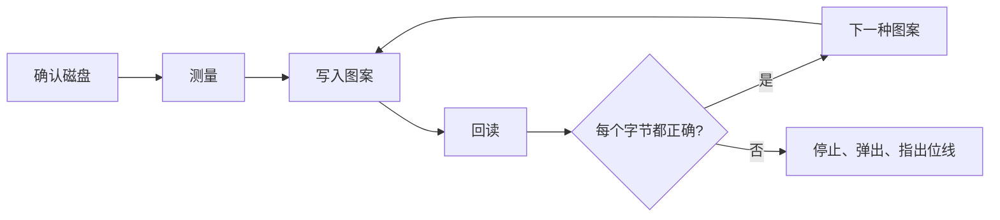

<div align="center">

<h1>kiyome</h1>

<strong>用五种经过校验的图案擦除软盘、Zip 盘、U 盘和硬盘，并指出出故障的位线。</strong>

[English](README.md) | [日本語](README.ja.md) | 简体中文 | [繁體中文 (香港)](README.zh-HK.md)

[](https://github.com/gufranco/kiyome/actions/workflows/ci.yml)
[](https://github.com/gufranco/kiyome/releases)
[](LICENSE)
[](#portability)

<p align="center">
  <a href="#quick-start"><strong>快速开始</strong></a> |
  <a href="#how-it-works">工作原理</a> |
  <a href="#development">开发</a>
</p>

</div>

一个命令，143 个测试，9 个 shell 模块，除 POSIX 系统外没有任何运行时依赖。`kiyome` 是日语"清め"，意为净化。它的姊妹工具 [kakikomi](https://github.com/gufranco/kakikomi) 用来写入磁盘镜像。

---

```console
$ kiyome /dev/disk6

Device: /dev/disk6, 64.0 MiB, DISK IMAGE
        Everything on it is erased, including:
          +67.1 MB disk6
Plan:   1 pass of unique data, 0xAA, 0x55, 0xFF and 0x00, each read back
        then eject

Type disk6 to erase, or anything else to stop: disk6
Unmounting /dev/disk6...
Disk unmounted
Measuring /dev/disk6 before wiping it, so every limit comes from this disk.
Measured read: 222666 KiB/s sustained, 26ms to reach a sector, allowing 3x that before stopping.
Measured write: 27028 KiB/s sustained, 27ms to reach a sector, allowing 3x that before stopping.
Pass 1 of 1, writing per-chunk unique data 100%  438.4 MiB/s  0m00s left
Pass 1 of 1, verifying per-chunk unique data 100%  237.9 MiB/s  0m00s left
Pass 1 of 1, writing 0xAA 100%  888.9 MiB/s  0m00s left
Pass 1 of 1, verifying 0xAA 100%  400.0 MiB/s  0m00s left
Pass 1 of 1, writing 0x55 100%  941.2 MiB/s  0m00s left
Pass 1 of 1, verifying 0x55 100%  240.6 MiB/s  0m00s left
Pass 1 of 1, writing 0xFF 100%  888.9 MiB/s  0m00s left
Pass 1 of 1, verifying 0xFF 100%  390.2 MiB/s  0m00s left
Pass 1 of 1, writing 0x00 100%  711.1 MiB/s  0m00s left
Pass 1 of 1, verifying 0x00 100%  280.7 MiB/s  0m00s left
Wiped /dev/disk6: every byte of every pattern read back as written.
Ejecting /dev/disk6...
Ejected. /dev/disk6 is safe to remove.
```

<a id="quick-start"></a>

## 快速开始

### 前置条件

| 工具 | 用途 | 安装 |
|:-----|:----|:--------|
| POSIX `sh`、`dd`、`cmp`、`od` | 工具本身 | macOS 和 Linux 已预装，不需要 `bash` |
| `openssl` | 每块各不相同的图案 | 已预装 |
| `newfs_msdos`，或 `sfdisk` 和 `mkfs.fat` | macOS 或 Linux 上的 `--create` | macOS 已预装；Linux 上为 `apt install fdisk dosfstools` |
| `mkfs.exfat` | Linux 上对超过 32 GiB 的磁盘使用 `--create` | `apt install exfatprogs` |

### 安装

```bash
brew install gufranco/tap/kiyome
```

也可以从源码安装：

```bash
git clone https://github.com/gufranco/kiyome.git
cd kiyome
make install
```

`make install` 把工具、man 手册以及 bash、zsh、fish 补全复制到 `~/.local` 下，并把 `kiyome` 放进 `~/.local/bin`；设置 `PREFIX` 可以改变位置。Homebrew formula 安装的是同样的文件。

### 验证

```console
$ kiyome doctor
```

## 用法

| 命令 | 用途 |
|:--------|:--------|
| `kiyome [options] <device\|mount_point>` | 用五种经过校验的图案覆盖该磁盘，然后弹出 |
| 不带参数的 `kiyome` | 在终端中运行时，询问磁盘和轮数 |
| `kiyome doctor` | 列出 kiyome 需要的工具以及是否已安装 |
| `kiyome version`、`kiyome help` | 显示版本或完整用法 |

| 选项 | 效果 |
|:-------|:-------|
| `--passes N` | 把五种图案重复 N 次，默认 1 次 |
| `--create` | 最后留下一个全新的 FAT32 或 exFAT 文件系统，而不是空白磁盘 |
| `--allow-internal` | 允许内置磁盘。运行中系统所在的磁盘始终被拒绝 |

也可以写成 `--passes=3`，`--` 表示选项结束。环境变量 `PASSES=N`、`CREATE=y` 和 `ALLOW_INTERNAL=y` 设置的是同样的选项，命令行上的选项优先。

```bash
kiyome /dev/disk4                 # 一遍，然后弹出
kiyome --passes 3 /dev/sdb        # 三遍
kiyome /Volumes/USB               # 已挂载的卷代表它所在的整个磁盘
kiyome --create /Volumes/USB      # 最后留下 FAT32 或 exFAT 文件系统
```

磁盘可以用设备名指定，例如 `/dev/disk4`，也可以用它挂载出的任何卷指定，例如 `/Volumes/USB`；kiyome 会找出卷背后的整个磁盘，并擦除整个磁盘。

kiyome 遵循同系列工具共用的命令行约定，详见 [FAMILY.md](FAMILY.md)。

<a id="how-it-works"></a>

## 工作原理

每一轮写入五种图案，每种都回读后才进入下一种：每块各不相同的 AES-CTR 数据，然后是 `0xAA`、`0x55`、`0xFF` 和 `0x00`。各不相同的数据能发现从缓存应答、或把两个地址映射到同一位置的磁盘。四种固定图案让每一位都分别处于 0 和 1。

错误的字节会连同相关位线一起报告。总是同一条位线出错，说明线缆、转接器或驱动器中有卡住的数据线；错误分散则说明介质老化。



kiyome 先测量磁盘自身的速度，再据此给每次传输设定期限。不匹配、停顿或设备消失都会立即停止并弹出磁盘。

| 驱动器 | 处理方式 |
|:------|:----------|
| Zip、Jaz、PocketZip | 期限更严且不重试；停顿被视为磁头偏离，偏离的磁头会损坏它遇到的下一张盘片 |
| 软盘、SuperDisk | 不重试，并等待你取出磁盘，因为这些驱动器无法用软件弹出 |
| 其他 | 每块尝试三次，然后停止 |

运行中系统所在的磁盘始终被拒绝，已挂载的卷会在写入之前卸载。

<a id="portability"></a>

## 可移植性

全部代码都是 POSIX `sh`，ShellCheck `-o all` 零发现，没有禁用任何检查。测试套件在 macOS 的 `/bin/sh`、`dash`、`bash`、`bash --posix` 和 `zsh` 下运行，也在特权容器中的 Ubuntu 上以相同的 shell 运行。

<a id="development"></a>

## 开发

| 命令 | 说明 |
|:--------|:------------|
| `make lint` | 对每个脚本和补全运行 ShellCheck，用 mandoc 检查 man 手册，并检查没有函数被重复定义 |
| `make test` | 在系统 `sh` 下运行 143 个 `bats` 测试 |
| `make test-all` | 在每个已安装的 shell 下运行同样的测试 |
| `make test-linux` | 从 Mac 在特权 Ubuntu 容器中运行同样的测试 |
| `make coverage` | 在这台 Mac 和同一容器中用 bashcov 测量行覆盖率并合并，CI 要求 100% |

测试用 `hdiutil` 或 `losetup` 挂接以文件为后端的磁盘，并真实擦除。CI 在 Ubuntu 和 macOS 上运行。每次推送到 `main` 都会运行 semantic-release：含 `feat` 或 `fix` 提交时会发布 release，更新 [`lib/core.sh`](lib/core.sh) 中的 `KIYOME_VERSION` 和 CHANGELOG，并更新 Homebrew formula。

## 许可证

[MIT](LICENSE)
